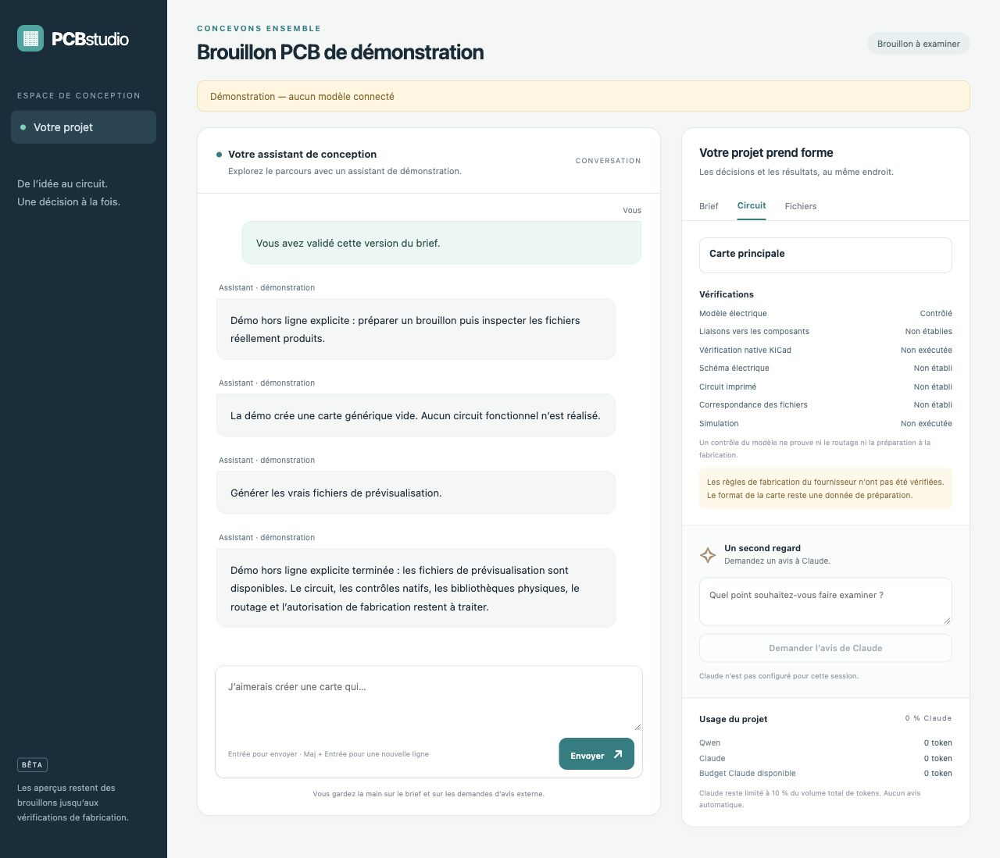

# pcb_dev

**Describe your idea; self-hosted Qwen clarifies the brief and manages engineering
tools in a local studio.** Conversation, plan, evidence and revisions persist with
the project. Claude provides human-requested reviews with a project-wide 10% token
ceiling. See the [studio guide](docs/studio.md).

**Model a PCB as nested blocks, validate interfaces before layout, and preserve
the evidence behind every check.**

[Français](README.md) · [Architecture](docs/architecture.md) · [Roadmap](docs/roadmap.md)

**Alpha**. Python 3.11+, no third-party runtime dependencies.
KiCad is the CAD backend; this project adds the block model, deterministic checks,
CLI, review artifacts, and optional engineering-tool adapters.



Studio preview in explicit scripted demonstration mode, without a connected model.

## Quick start

```sh
git clone https://github.com/Matt95354855/pcb_dev.git
cd pcb_dev
python -m venv .venv
source .venv/bin/activate
# Windows PowerShell: .venv\Scripts\Activate.ps1
python -m pip install -e .
pcb-dev studio --project build/studio-demo --demo
```

Open <http://127.0.0.1:8788>, enter an idea and approve the brief. The explicit
scripted demo builds an empty generic board to exercise the workflow; it does
not design the requested circuit or connect to a model. For real Qwen setup,
resuming a project and optional Claude reviews, see the [studio guide](docs/studio.md).

Use `--review-patches` for human decisions over validated patch batches and
`--hierarchical` for one KiCad sheet per block. Immutable design versions support
read-only semantic comparison. See [change review](docs/reviewing-changes.md),
[hierarchical schematics](docs/hierarchical-schematics.md) and
[declared decoupling rules with actual pad measurements](docs/decoupling.md).

The engineering CLI remains available:

```sh
pcb-dev doctor
pcb-dev check examples/usb_mcu_led.json
pcb-dev build examples/usb_mcu_led.json --output build/demo
pcb-dev verify build/demo
python -m unittest discover -s tests -v
```

Open `build/demo/index.html` for an offline block viewer. KiCad preview files are
in `build/demo/kicad/`. Every build requires a new output directory and refuses
to overwrite existing work.

For a draft using actual pinned KiCad library symbols and footprint geometry:

```sh
pcb-dev build examples/library_divider/design.json \
  --bindings examples/library_divider/bindings.json --output build/library-divider
pcb-dev verify build/library-divider
```

Every component needs a complete binding; missing sources never fall back to
generic geometry. Sources, hash pins, licenses, and attribution are bundled for
offline reconstruction. The initial implementation supports single-unit symbols
and top-side placement. See the [library generation guide](docs/library-generation.md).

## Implemented scope

- Prompt-first studio, human brief approval, dependency-aware plan, persistent
  conversation and guarded design/build/native-check/simulation tools.
- Self-hosted Qwen manager; separate human-only Claude reviews, persistent actual
  usage accounting, advance reservations and a 10% project token policy. No real
  Qwen endpoint or Claude API has yet been qualified by this project.

- Strict versioned JSON with typed ports, nested blocks, explicit dependencies,
  components, DNP flags, and placement declarations.
- Parameter inheritance, safe arithmetic equations, boolean constraints,
  dependency cycles, change impact, and contextual frozen-block fingerprints.
- Worst-case voltage containment, shared-net power budgets, incompatible
  interfaces, output conflicts, required ports, I²C addresses, sequencing, and
  explicitly declared component limits.
- JSON/Markdown findings, design-bound human waivers, SHA-256 manifests,
  reproducible preview archives, BOMs, and draft placement files.
- Deterministic generic KiCad previews; optional native KiCad 9/10 ERC/DRC and
  export adapters with tool/version/source evidence.
- Data-only pinned block packages and KiCad library inventories, atomic
  reversible edits, explicit passive SPICE models, and bounded agent proposals.
- Optional compatible model endpoint with explicit remote opt-in, local-only
  offline mode, strict tools, budgets, and secret-redacted traces.

```sh
pcb-dev graph examples/usb_mcu_led.json --impact board.power
pcb-dev inspect examples/usb_mcu_led.json
pcb-dev check examples/invalid_voltage.json     # exits 1
pcb-dev check examples/invalid_power_budget.json # exits 1
pcb-dev archive build/demo --output build/demo-preview.zip
pcb-dev spice examples/rc_filter.json --analysis tran --output build/rc.cir
pcb-dev agent-demo examples/usb_mcu_led.json \
  --script examples/agent_session.json --output build/agent-review
```

Exit status: `0` completed successfully, `1` validation blocked, `2` invalid input
or operational failure, `130` interrupted.

## Engineering status

Ports can declare an exact global net and local component/pin targets.
`--require-physical-ports` on `check`, `build`, or `native-check` requires every
declared port to be realized by fitted pins. Contradictory net mappings block
drafts as well. `native-check --bindings` adds strict real-library pin and
explicit no-connect parity. See the [physical interface guide](docs/physical-ports.md)
and [bound parity contract](docs/bound-parity.md). These checks do not qualify a board for manufacturing.

Default generated symbols and pads are **generic previews**, not qualified physical parts.
The optional library-backed mode preserves real library geometry and pin types;
part qualification, routing and fabrication approval remain pending.
The MCU example has a fictional demonstration pinout. `build` does not route a board,
run native ERC/DRC, or approve manufacturing. Checks operate on declared data;
they cannot infer missing datasheet limits or actual device behavior.

The manufacturing milestone remains open: real selected parts, qualified KiCad
libraries, model/schematic/PCB parity, routing, zero native ERC/DRC violations,
reviewed Gerbers/BOM/CPL, and versioned supplier rules. Manufacturer profiles are
conservative planning assumptions, not certified capability tables.

Native checks require an installed KiCad CLI:

```sh
pcb-dev doctor --require-kicad
pcb-dev native-check examples/usb_mcu_led.json \
  --board your-board.kicad_pcb --schematic your-schematic.kicad_sch \
  --output build/native-review
```

Missing tools, malformed reports, ignored checks, exclusions, and violations fail
closed. Native checks alone cannot qualify manufacturing. Python adapter tests
are separate from native KiCad CI. See [backend documentation](docs/backends.md),
[security](SECURITY.md), and [contribution guidelines](CONTRIBUTING.md).

No supplier order, GPU rental, or model API request runs by default. Code: MIT.
Vendored KiCad library data retains its [upstream licenses and attribution](examples/library_divider/ATTRIBUTION.md).

Further docs: [blocks/packages](docs/blocks.md), [libraries](docs/libraries.md),
[SPICE](docs/spice.md), [agent](docs/agent.md), [model endpoints](docs/providers.md), [Qwen evaluation](docs/model-evaluation.md).
