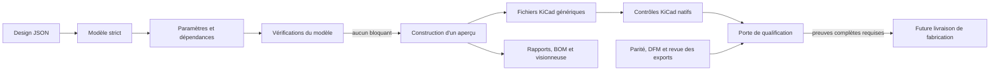

# Architecture et décisions

## ADR 001 — Une couche de logique au-dessus de KiCad

Le modèle porte les blocs, les interfaces, les dépendances et les contraintes.
KiCad reste responsable des formats natifs, de l'ERC, du DRC et des exports CAO.
Freerouting et NgSpice restent des outils externes optionnels.

Le MVP cible les cartes basse tension de 2 ou 4 couches pour hobbyistes avancés
et petites équipes hardware. RF, DDR/PCIe, isolation haute tension, HDI et
certification normative sont hors du périmètre de cette alpha.

## ADR 002 — Python et JSON strict avant une interface d'édition

Python 3.11+ apporte un runtime accessible et des adaptateurs EDA simples. La
bibliothèque standard suffit pour exécuter le cœur. Les modèles sont des objets
typés mais l'entrée de confiance est `Design.from_dict`/`load_design` : les
dataclasses seules ne remplacent pas une validation.

JSON constitue le format canonique v1 : diffable, sans code exécutable, sans
constructeurs YAML, sans dépendance à un modèle IA. Les champs inconnus et les
coercitions silencieuses sont refusés. Les quantités ont des unités explicites
dans le nom de leur champ. Les métadonnées libres ne constituent pas des preuves.

## ADR 003 — Une validation doit être prouvée

Un rapport possède un stade, un hash de design, des constats et un état de
complétude. Un rapport absent ou incomplet bloque une porte. Les rapports
natifs doivent aussi attester leur origine native. Un code de sortie nul ne
suffit pas : le backend vérifie le rapport et les fichiers attendus.

Un aperçu peut être construit après la vérification du modèle pour faciliter
la revue. Cette opération n'ouvre pas la porte de layout qualifié C16 et ne
constitue pas une exportation finale I15. La commande `archive` archive le
statut existant ; elle ne le transforme pas en validation de fabrication.

Les dérogations sont exactes : empreinte du constat, hash du design, acteur,
motif, date et approbation humaine explicite. Un changement de design les
invalide. Les preuves manquantes d'une porte ne peuvent pas être dérogées.

## ADR 004 — Reproductibilité et intégrité

La construction utilise un dossier temporaire puis publie le résultat complet.
Elle refuse de remplacer un dossier existant. Les UUID, l'ordre des nets,
l'encodage JSON et les timestamps de ZIP sont déterministes. Les rapports
natifs peuvent contenir des dates et ne promettent pas la reproductibilité
binaire d'un outil externe.

Un manifeste SHA-256 détecte les fichiers modifiés, manquants ou supplémentaires.
C'est une preuve d'intégrité locale, pas une signature d'auteur ou une preuve
qu'un design est électriquement correct.

## ADR 005 — L'agent propose, les vérificateurs décident

Les futurs fournisseurs IA utilisent la même interface. Les outils d'agent ont
des arguments stricts et des budgets. Les modifications passent par une copie
transactionnelle, les blocs gelés et les contrôles de non-régression. L'agent
ne dispose pas d'un outil pour lever une porte, approuver une dérogation,
lancer un shell ou commander une carte.

Les noms de modèles et les chiffres matériels de la todo list sont des pistes
à vérifier, pas des configurations approuvées. Aucun modèle particulier ni
GPU loué n'est imposé par le format de design.

## Organisation du code

| Module | Responsabilité |
| --- | --- |
| `model`, `graph`, `expressions` | Structure, contexte, dépendances et calculs sûrs |
| `checks`, `reports` | Contrôles déterministes, constats, dérogations et portes |
| `backends` | Fichiers KiCad et outils externes bornés |
| `catalog`, `fabrication` | Données de composants, sélection et tables d'assemblage |
| `pipeline`, `artifacts` | Aperçus, documentation et intégrité des fichiers |
| `cli`, `web` | Interface de commande et revue locale |

## ADR 006 — Bibliothèques explicites et brouillon autonome

Une construction peut utiliser un fichier de liaisons distinct du modèle pour
associer chaque composant à un symbole et à une empreinte KiCad épinglés. Les
sources sont lues une fois, vérifiées par hash et capturées avec les licences.
La construction copie ce snapshot dans les artifacts, ce qui permet une reprise
hors ligne sans dépendre de la bibliothèque installée sur un autre ordinateur.

Les types électriques et la géométrie de bibliothèque sont conservés. Les unités,
conversions et transformations non prises en charge sont refusées. Aucun mélange
silencieux avec des pads génériques n'est autorisé. Les modèles 3D externes restent
des données de référence : ils ne sont pas résolus automatiquement dans le PCB généré.

Le statut `library-draft` reste distinct d'une qualification de fabrication. Les
sources de bibliothèque ne prouvent ni le pinout de la référence commerciale, ni
la valeur des composants, ni le routage, ni les règles réelles du fabricant.

## ADR 007 — Intention physique explicite et preuves NC séparées

`Port.net` et `Port.pin_bindings` expriment une intention vers les broches du même
bloc. Les anciens ports restent abstraits ; un mode strict exige une réalisation
montée complète. Une incohérence de nets bloque même un brouillon. Le calcul ne
renomme jamais le cuivre et n'infère pas la fonction datasheet d'un composant.
Les noms de nets explicites relient aussi les contrôles de conflits et budgets
lorsqu'aucune arête logique n'est présente.

La parité avec bibliothèques utilise un comparateur distinct. Les états NC doivent
être explicitement demandés dans les bindings et reconnus dans l'export natif,
avec des pads sans net. Le parseur général conserve son comportement strict.
Les hash de l'export netlist, du schéma et du PCB sont reliés aux étapes natives ;
une modification entre étapes bloque le gate. Aucune de ces preuves ne certifie
le cuivre, une datasheet ou le procédé fabricant.

## Mesures de réussite

À ce stade : entrées invalides rejetées, exemples incorrects bloqués, paramètres
résolus de façon stable, tests de non-régression et aperçus reproductibles.
Le critère de sortie du MVP physique reste une carte réelle passant ERC et DRC
natifs sans erreur et accompagnée d'exports relus. Ce critère n'est pas remplacé
par un nombre de tests Python.

## ADR 008 — Studio persistant et Qwen manager

`studio.py` sert les assets locaux et une API JSON bornée. Les actions humaines
sont exécutées en arrière-plan avec une seule écriture à la fois ; le navigateur
lit un snapshot détaché. L'approbation transmet le hash du brief affiché pour
refuser les validations depuis un onglet périmé.

`project.py` orchestre Qwen avec des tours bornés et les outils déclarés dans
`project_tools.py`. Le brief est approuvé par l'humain avant création ou mutation
du modèle. Les outils réemploient transactions, preflight, pipeline, KiCad natif
et Ngspice. Une erreur réelle est renvoyée au modèle ; aucun texte du modèle ne
crée une preuve. Le contrat du design est exposé comme donnée au manager.
La session ne possède ni shell ni outil de réseau arbitraire.

`project_store.py` persiste atomiquement l'état courant et un audit chaîné sous
verrou OS. `quota.py` conserve séparément les tokens rapportés et les réservations
Claude : changer de révision ne recrée aucun crédit. Les hashes détectent une
altération relative au journal local ; ils ne constituent pas une signature.

`claude.py` traduit le protocole natif Messages et demande une autorisation pour
chaque appel. Le manager expose cette revue uniquement à l'action humaine du
studio. Claude ne reçoit aucun outil dans ce parcours. L'admission repose sur
le volume de tokens du projet, une estimation majorée et une réserve de sortie ;
les consommations inconnues bloquent les appels suivants.

La qualification d'un vrai Qwen reste distincte des tests du contrôleur. Les
smokes du manager utilisent un fournisseur scénarisé explicite avec de vrais
moteurs KiCad/Ngspice dans la CI. Voir [le guide du studio](studio.md).
