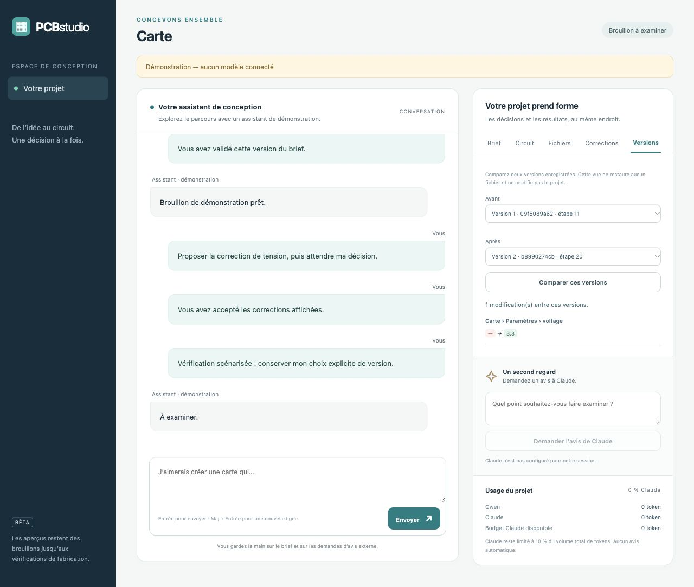

# Examiner les corrections proposées par Qwen

Le manager peut travailler avec des corrections transactionnelles automatiques ou
avec une revue humaine par lot. Le brief initial doit être approuvé dans les deux
modes ; ni Qwen ni Claude ne peuvent s'accorder cette approbation.

```sh
pcb-dev studio --project build/ma-carte --model IDENTIFIANT_SERVI \
  --review-patches
```

Le profil du modèle et les options réseau restent ceux du [guide du studio](studio.md).
`--review-patches` active la revue des corrections ; un redémarrage sans cette
option conserve la politique du projet. `--auto-patches` demande explicitement
le retour aux corrections automatiques, sous les mêmes contrôles. Une proposition
en attente doit être traitée avant de changer de mode.

## Proposer, examiner, décider

Qwen prépare un lot borné avec sa raison. Le serveur l'applique d'abord sur une
copie, vérifie les exigences existantes, le gel et les régressions, puis calcule
le diff et les rapports avant/après. Le design courant ne change pas à ce stade.

Dans le studio, examiner les composants, broches, paramètres ou connexions touchés
et les constats ajoutés/résolus. Les textes de Qwen restent des explications ; le
diff provient du modèle structuré. Accepter transmet le hash exact du lot affiché.
Le serveur recharge le projet sous verrou et refuse la décision si le design ou
le brief ont changé depuis la proposition. Une requête répétée n'applique pas deux
fois le même lot. Rejeter conserve le design et enregistre la décision et son motif.

Accepter ou rejeter ne déclenche pas d'appel de modèle ou de revue Claude implicite.
Envoyer un nouveau message pour demander à Qwen de poursuivre. Les anciennes
preuves de contrôles restent conservées et sont marquées périmées si le design a
changé ; elles ne qualifient jamais automatiquement la nouvelle version.

## Comparer les versions

Chaque création ou modification acceptée conserve un snapshot canonique adressé
par son hash. L'historique du studio permet de comparer deux versions en lecture
seule. Les composants sont rapprochés par identifiant et les broches par numéro ;
un réordonnancement de listes ne simule pas une suppression et une recréation.

Le serveur contrôle l'appartenance au projet et l'intégrité des snapshots avant
comparaison. Un snapshot absent ou modifié n'est jamais reconstruit depuis le récit
du modèle. Cette tranche fournit l'historique et le diff ; elle ne restaure pas
aveuglément une ancienne version qui pourrait contourner les contraintes actuelles.

Le registre de tokens reste séparé des versions et des décisions : une revue,
un redémarrage ou une comparaison ne recrée aucun crédit Claude. Les hashes locaux
ne constituent pas une signature contre un administrateur qui remplace les fichiers.




Parcours vérifié avec un fournisseur scénarisé explicite, sans modèle connecté.
